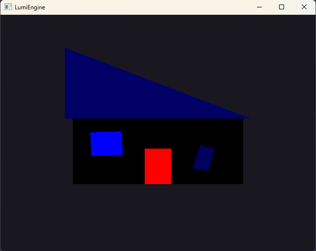
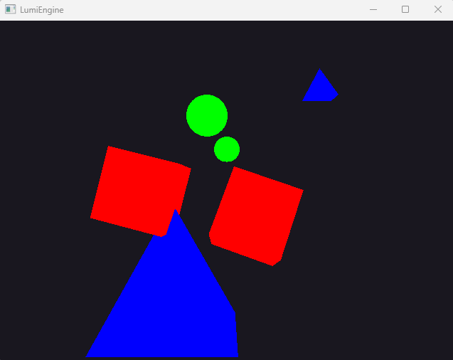

# Lumi Engine
------

# Install
Add **compile_commands.json** file with command `xmake project -k compile_commands`

Generate **.sln** files with `xmake project -k vsxmake`

To compile the program just run `xmake` and then to run the program `xmake run`
Or run the `compile.sh` file to compile and run the program.

---
# Week 1
**Tag Version:** `Week1/2dHouse` 

This week I implemented render of a house with triangles and quads. With the refactor I started with abstraction of the objects to a mesh class and child classes of the mesh class, so I can easily create more objects such as circle, cubes, or planes easier. 

To change the rooftop color use the space key

This is the house progress.

---
# Week 2 
**Tag Version:** `Week2/3dObject`

This week I implemented rendering of basic 3D Objects in world. With it I also implemented 
projection matrices, view matrix and model matrix that would be renderd in the world.

The Basic Objects is Cube, Pyramid, Sphere.
Each of the different objects ether moves, rotates or scales 

There is two different projection matrices that we can switch between with keypress `2`. 
The two is `Perspective` and `Orthographic` projection.

