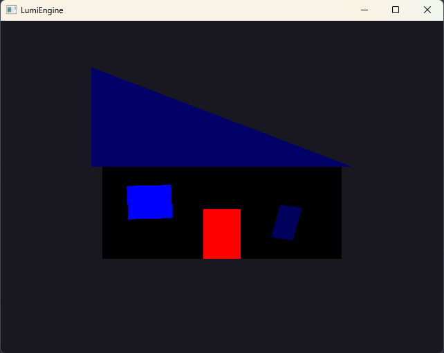
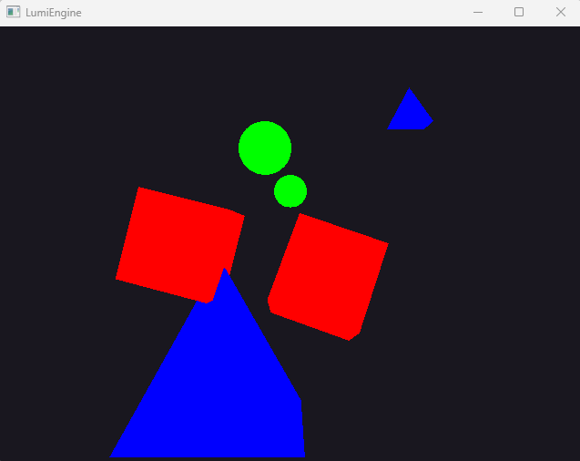
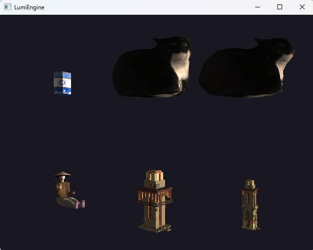
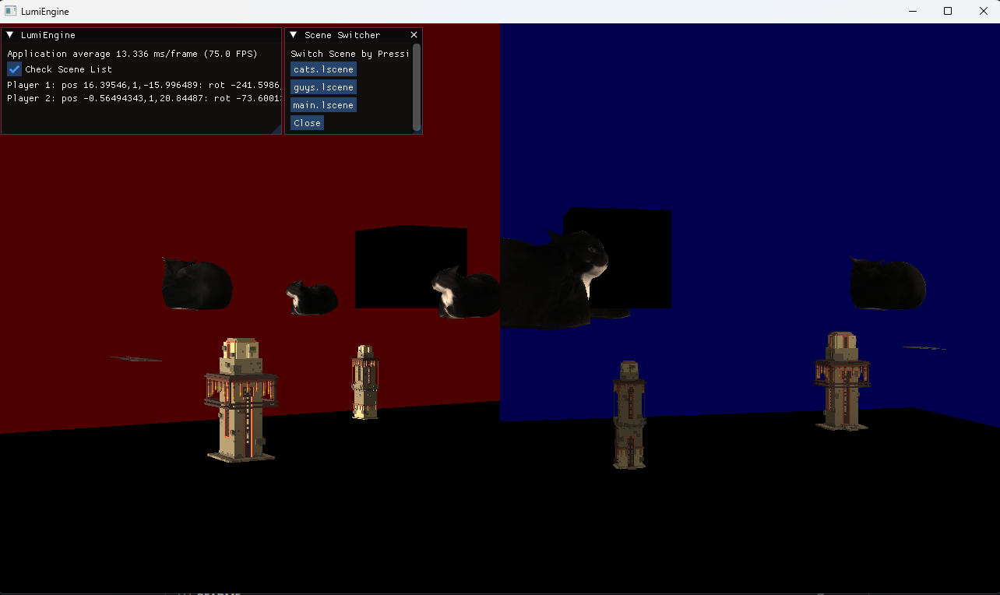

# Lumi Engine
------

# Dependencies
- xmake
- c++ 20
- glfw
- glad
- glm
- stb
- minizip
- assimp

# Install
Add **compile_commands.json** file with command `xmake project -k compile_commands`

Generate **.sln** files with `xmake project -k vsxmake`

To compile the program just run `xmake` and then to run the program `xmake run`
Or run the `compile.sh` file to compile and run the program.

---
# Week 1
**Tag Version:** `Week1/2dHouse` 

This week I implemented render of a house with triangles and quads. With the refactor I started with abstraction of the objects to a mesh class and child classes of the mesh class, so I can easily create more objects such as circle, cubes, or planes easier. 

To change the rooftop color use the space key

This is the house progress.

---
# Week 2 
**Tag Version:** `Week2/3dObject`

This week I implemented rendering of basic 3D Objects in world. With it I also implemented 
projection matrices, view matrix and model matrix that would be renderd in the world.

The Basic Objects is Cube, Pyramid, Sphere.
Each of the different objects ether moves, rotates or scales 

There is two different projection matrices that we can switch between with keypress `2`. 
The two is `Perspective` and `Orthographic` projection.

---
# Week 3 
**Tag Version:** `Week3/ObjectLoader`

This week I have implemented two different object loaders. One custom made and the other with Assimp.

We have added 5 different objects that we can load in. We also have added a resource manager where we
can get or create new object meshes, so we dont create duplicate models.

We have also added a lighting model of Phong. This is so we can create shadows on the objects and to 
test the normals if they are correct on the models we are loading in.

---
# Week 4 
**Tag Version:** `Week4/SplitScene`

This week I have implemented two player split screen and scene loader, using my own formatting.

How the split screen works is by modifying an int variable `activePlayers` from a 1 to 2, and then it will 
give me split screen mode or single mode.

| Action | Player 1 | Player 2 |
| --------------- | --------------- | --------------- |
| Forward | W | Up |
| Backward | S | Down |
| Yaw Right | D | Right |
| Yaw Left | A | Left |
| Pitch Up | E | PgUp |
| Pitch Down | Q | PgDn |

How to switch scene then is with the gui library ImGui. Where we have the potions for where we can 
see some stats about the game and player Transforms. Right now we have three different scenes we can 
switch between.

---

